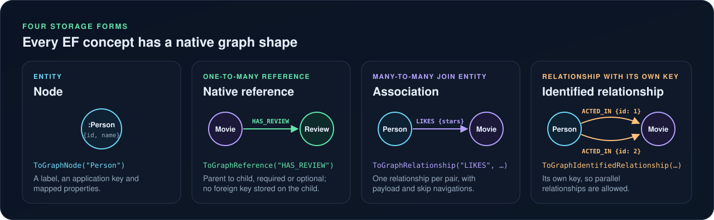
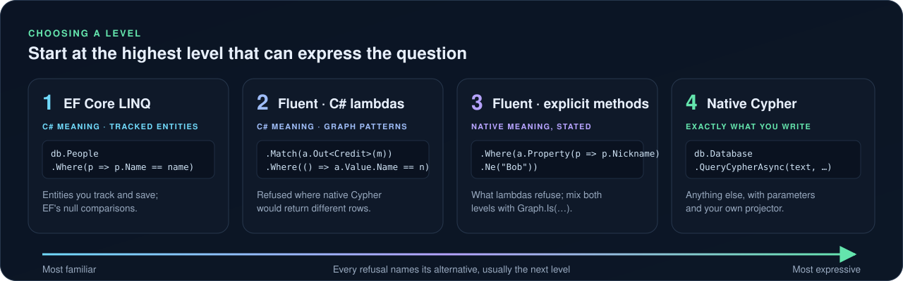
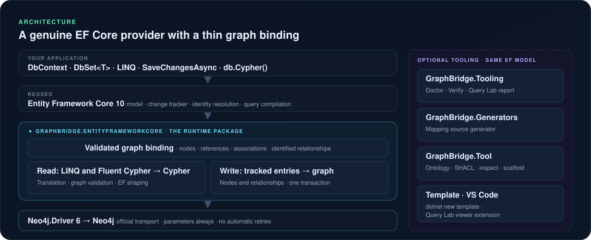

<h1 align="center">
  <br>
  GraphBridge
</h1>

<p align="center"><a href="docs/README.md"></a></p>

> **Developer preview. Not production-supported yet.** APIs, mappings and generated artifacts may change between previews; pin exact versions and read the [changelog and breaking-change policy](CHANGELOG.md) before upgrading. Install it from nuget.org with `dotnet add package GraphBridge.EntityFrameworkCore --prerelease`.
>
> **Async only.** Use `SaveChangesAsync()` and async query methods; synchronous persistence and entity-query enumeration are refused ([why](docs/architecture/adr/ADR-0037.md)).

GraphBridge is a real, non-relational Entity Framework Core 10 provider for Neo4j. EF Core owns your model, entity identity and change tracking; the official Neo4j .NET driver owns the connection; GraphBridge stores entities as nodes and relationships and translates queries into parameterized Cypher. There is no second ORM, no client-side query fallback and no hidden schema change. Every supported behavior is tested against a real Neo4j database.

New here? Read the [visual introduction](https://joslat.github.io/GraphBridge.EFCore/WHAT_IS_GRAPHBRIDGE.html) or browse the [documentation site](https://joslat.github.io/GraphBridge.EFCore/), then [get started](docs/GETTING_STARTED.md) or take the [workshop](workshop/README.md).

## Every EF concept has a native graph shape



```csharp
model.Entity<Person>().ToGraphNode("Person");
model.Entity<Review>().HasOne(r => r.Movie).WithMany(m => m.Reviews)
    .HasForeignKey(r => r.MovieId).ToGraphReference("HAS_REVIEW");   // (:Movie)-[:HAS_REVIEW]->(:Review)

var options = new DbContextOptionsBuilder<MoviesContext>()
    .UseNeo4j(driver, databaseName: "neo4j")      // your application owns the driver
    .Options;
await using var db = new MoviesContext(options);
var name = "Keanu Reeves";
var people = await db.People.Where(p => p.Name == name)
    .OrderBy(p => p.Name).Take(10).ToListAsync();  // one parameterized Cypher statement
```

Keys are application keys backed by reviewed uniqueness constraints; GraphBridge never creates schema on its own. See [concepts](docs/CONCEPTS.md), [mapping nodes](docs/features/MAPPING_NODES.md), [references](docs/features/REFERENCES.md), [associations](docs/features/ASSOCIATIONS.md) and [identified relationships](docs/features/IDENTIFIED_RELATIONSHIPS.md).

## Three ways to query



| Surface | Use it for | Guide |
|---|---|---|
| EF Core LINQ | Tracked entities and DTOs with EF's C# semantics | [LINQ queries](docs/features/LINQ_QUERIES.md) |
| Fluent Cypher | Typed graph patterns, optional matches, counts, aggregates, EXISTS and paths, with native semantics | [Fluent Cypher](docs/features/FLUENT_CYPHER.md) |
| Native Cypher | Anything else, as reviewed parameterized text with your projector | [Native Cypher](docs/features/NATIVE_CYPHER.md) |

Shapes that cannot be translated faithfully are refused with a code (GBQ for LINQ, GBFC for Fluent Cypher) and an alternative: [known limitations](docs/reference/KNOWN_LIMITATIONS.md).

## Features

| Area | What you get |
|---|---|
| Writing | Atomic `SaveChangesAsync`, explicit transactions shared with every query surface, optimistic concurrency, restrictive deletes: [transactions and concurrency](docs/features/TRANSACTIONS_AND_CONCURRENCY.md), [bulk update and delete](docs/features/BULK_MUTATIONS.md) |
| Graph-native reads | [Bounded paths](docs/features/BOUNDED_PATHS.md), [vector and full-text search](docs/features/GRAPH_SEARCH.md) with native scores, also through `IVectorSearchable<TRecord>` with the optional [VectorData adapter](docs/features/VECTOR_DATA.md) |
| Types | Explicit [null, type and time semantics](docs/features/NULLS_TYPES_AND_TIME.md), including Guid, enum and `DateTimeOffset` |
| Schema and change | A storage manifest, read-only schema inspection with reviewed proposals, typed migration plans with a journal and recovery: [schema and migrations](docs/features/SCHEMA_AND_MIGRATIONS.md) |
| Observability | [Query inspection](docs/features/QUERY_INSPECTION.md) with `ToQueryString` and server EXPLAIN, and [command tracing](docs/features/COMMAND_TRACING.md) without leaking values |

## Tools

Optional, built on the same EF model, never needed at runtime: [Doctor](docs/tools/DOCTOR.md) diagnoses the model, queries and schema; [Verify](docs/tools/VERIFY.md) compiles, plans and compares registered queries; [Query Lab](docs/tools/QUERY_LAB.md) shows C#, Cypher and evidence side by side as HTML or in VS Code; the [mapping generator](docs/tools/MAPPING_GENERATOR.md) writes EF configuration from attributes; [GraphBridge.Tool](docs/tools/GRAPHBRIDGE_TOOL.md) compiles ontologies and scaffolds from an existing graph; plus a [project template](docs/tools/TEMPLATE.md) and [design-time commands](docs/tools/DESIGN_TIME.md).

## Learn

| Start with | |
|---|---|
| [Getting started](docs/GETTING_STARTED.md) | Install, configure, map an entity, save it and see the Cypher |
| [Workshop](workshop/README.md) | 31 runnable lessons, about three hours for the core track |
| [Samples](samples/README.md) | Code-first, ontology-first and database-first applications, design-time commands and a Fluent Cypher gallery |
| [Documentation](docs/README.md) | Every feature, tool and reference page; it also builds as a site with `eng/scripts/Build-DocsSite.ps1` |

## Architecture



One runtime package on top of EF Core 10 and Neo4j.Driver 6, pinned to exact versions. See the [architecture overview](docs/architecture/ARCHITECTURE.md) and the [decision records](docs/architecture/ARCHITECTURE_DECISIONS.md).

## Build and test

Install the .NET SDK pinned in `global.json` (10.0.401), then:

```powershell
dotnet restore GraphBridge.sln --locked-mode
dotnet build GraphBridge.sln --no-restore
```

Live tests run against a [disposable Neo4j](eng/README.md) and skip visibly without it; see [tests/README](tests/README.md). Public CI is manual and checks build and packaging. What has been verified, and how, is in the [verification summary](tests/verification/VERIFICATION_SUMMARY.md); what is supported is in [compatibility](docs/reference/COMPATIBILITY.md). To contribute, read [CONTRIBUTING](CONTRIBUTING.md).

## License

Original GraphBridge code and authored samples are [MIT licensed](LICENSE). Dependencies keep their own licenses; see [third-party notices](THIRD_PARTY_NOTICES.md).
