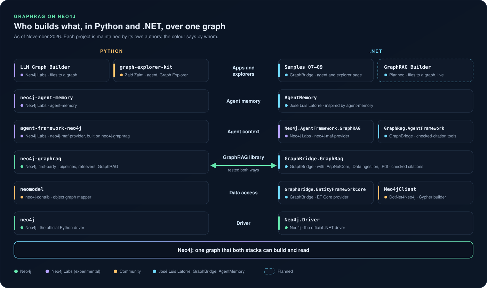

# Coming from Python

GraphRAG on Neo4j grew up in Python. Neo4j's own [`neo4j-graphrag`](https://github.com/neo4j/neo4j-graphrag-python) package, the Neo4j Labs projects around it and the community's kits worked out what a knowledge graph adds to retrieval: a lexical graph of documents and chunks, extraction held to a schema, retrievers that follow the graph out from a match, and agents that call them as tools. GraphBridge's GraphRAG toolkit learned most of what it does from that work, and it is designed to share a graph with it.

This page is for Python developers trying .NET, and for .NET developers reading Python examples. It maps each Python piece to its .NET counterpart, maps Neo4j's sample repositories to GraphBridge's samples, and says plainly what isn't in .NET yet.

Checked on 3 November 2026 against `neo4j-graphrag` 1.22.0 (the version the [interop suite](graphrag/INTEROP.md) runs; 1.23.0 is out), [neo4j-maf-provider](https://github.com/neo4j-labs/neo4j-maf-provider) at commit `e4636c8`, [graph-explorer-kit](https://github.com/ZaidZaim/graph-explorer-kit) at `4f6e2d2` and GraphBridge 0.2.0-preview.1. GraphBridge is an independent project: nothing here implies Neo4j's endorsement.

## Where it started

GraphBridge's GraphRAG work began alongside [Zaid Zaim](https://github.com/ZaidZaim)'s graph-explorer-kit: a GraphRAG scaffold on `neo4j-graphrag`, with an agent, conversations and the Graph Explorer, which draws an answer's evidence as it forms. Contributing to it, in [its first pull request](https://github.com/ZaidZaim/graph-explorer-kit/pull/1) in October 2026, and talking it through with Zaid, led to a simple idea: one graph, two stacks. A team should be able to build a graph in Python and answer from it in .NET, or the other way round, without rewriting anyone's data.

Neo4j's packages set the conventions to follow. GraphBridge's `Neo4jGraphRag` layout writes the same document and chunk names as `neo4j-graphrag`, its retriever presets carry the same names, and the interop suite runs both libraries on one database to check that each reads what the other writes.

## One repository, many roles

The Python side is a rich ecosystem, and each project in it does its own job very well. It is also spread across many repositories, organisations and release lines, so the first step is finding out which project does what. GraphBridge keeps the .NET pieces in one repository, with one documentation site, one version line and one test suite.

| Role | Python | .NET, in GraphBridge |
|---|---|---|
| Talking to Neo4j | [neo4j-python-driver](https://github.com/neo4j/neo4j-python-driver) | Uses the official [Neo4j .NET driver](https://github.com/neo4j/neo4j-dotnet-driver) |
| Objects in the graph | [neomodel](https://github.com/neo4j-contrib/neomodel), an object graph mapper | `GraphBridge.EntityFrameworkCore`, an EF Core provider |
| The GraphRAG library | [neo4j-graphrag](https://github.com/neo4j/neo4j-graphrag-python) | `GraphBridge.GraphRag`, with `.Pdf`, `.DataIngestion` and `.AspNetCore` |
| Its examples | [neo4j-graphrag's `examples`](https://github.com/neo4j/neo4j-graphrag-python/tree/main/examples) | [Samples](SAMPLES.md) 06–09 and the [workshop](WORKSHOP.md) |
| Agent context | [neo4j-maf-provider](https://github.com/neo4j-labs/neo4j-maf-provider) (Neo4j Labs) | `GraphBridge.GraphRag.AgentFramework` |
| An app with an agent and an explorer | [graph-explorer-kit](https://github.com/ZaidZaim/graph-explorer-kit) (Zaid Zaim) | [Sample 09](../samples/09-GraphRagArticles/README.md), with streaming endpoints and an explorer page |
| Example applications | [neo4j-examples](https://github.com/neo4j-examples)' movies apps | Samples [01](../samples/01-Blogging-CodeFirst/README.md) to [05](../samples/05-FluentCypher/README.md) |
| Files to a graph, visually | [LLM Graph Builder](https://github.com/neo4j-labs/llm-graph-builder) (Neo4j Labs) | Not yet: the GraphRAG Builder is on the [roadmap](../ROADMAP.md) |
| Memory for agents | [agent-memory](https://github.com/neo4j-labs/agent-memory) (Neo4j Labs) | Not in GraphBridge: [AgentMemory](https://github.com/joslat/agent-memory-dotnet), a separate .NET project by GraphBridge's author, inspired by it |

On the Python side, the roles GraphBridge covers are spread over at least five repositories in five GitHub organisations: neomodel, neo4j-graphrag with its examples, neo4j-maf-provider, graph-explorer-kit and the movies examples. It doesn't replace any of them, and they don't need it. It is one place to start for a .NET developer, with links back to the projects it learned from.

## neo4j-graphrag in .NET

| neo4j-graphrag | GraphBridge | Differences |
|---|---|---|
| `Embedder`, `LLMInterface` | Any `IEmbeddingGenerator<string, Embedding<float>>` and `IChatClient` from Microsoft.Extensions.AI | One client abstraction for every provider |
| `create_vector_index`, `create_fulltext_index` | `GraphRagSchema.CreateSteps`, applied as a reviewed [migration](features/SCHEMA_AND_MIGRATIONS.md) | Schema is never created behind your back |
| `SimpleKGPipeline`, from text or PDF | `IGraphRagIngestion.IngestAsync(GraphRagSources.Folder("docs"))` | Resumable runs with receipts; unchanged files are skipped |
| `schema`: node types, relationship types, patterns | An [ontology](graphrag/ONTOLOGIES.md) of C# classes; `GraphRagOntologies.Generic`, `.Novel` and `.Article` come with it | The ontology's classes are EF entities you query with LINQ |
| `FixedSizeSplitter` | The toolkit's chunker, or your own `IGraphRagChunker` | Every chunk keeps its exact byte span in the source |
| `PdfLoader`, `MarkdownLoader` | Markdown and plain text built in (`GraphRagSources.Folder`, `.File`, `.Text`); PDF with `AddGraphRagPdf()` from `GraphBridge.GraphRag.Pdf` | Page-aware citations for PDF |
| `LexicalGraphConfig` | `GraphRagLayout`; `GraphRagLayout.Neo4jGraphRag` writes neo4j-graphrag's names | Labels are chosen when you map the model |
| `VectorRetriever`, `HybridRetriever`, `VectorCypherRetriever`, `HybridCypherRetriever` | `GraphRagRetrievers.Vector()`, `.Hybrid()`, `.VectorCypher(cypher)`, `.HybridCypher(cypher)` | Hybrid results are fused by rank, not by normalised scores, so the order can differ ([retrieve](graphrag/RETRIEVE.md)) |
| `Text2CypherRetriever` | `AddGraphRagText2Cypher<TContext>()`, experimental and off by default | Read-only queries ([answers](graphrag/ANSWERS.md#questions-about-the-graph-experimental)) |
| `GraphRAG(retriever, llm).search(...)` | `IGraphRagAnswers.AnswerAsync(question)` | Every quote is checked against the stored bytes, or the answer is a refusal ([how](graphrag/ANSWERS.md)) |
| `GraphRAG.search` with `message_history` | `AnswerAsync` with `History`: the question is rewritten to stand alone first ([follow-ups](graphrag/ANSWERS.md#follow-up-questions)) | The rewrite and its outcome are on the evidence |
| Entity resolvers: exact, fuzzy and spaCy matchers | `GraphRagResolution.SuggestAsync`, then a merge plan with undo ([merging](graphrag/MAINTAIN.md#merging-duplicates)) | Suggestions you review, by exact normalised name or alias |

## Two context providers for Agent Framework in .NET

Neo4j Labs' [neo4j-maf-provider](https://github.com/neo4j-labs/neo4j-maf-provider) brings Neo4j to Microsoft Agent Framework in Python and in .NET. Its .NET package, [`Neo4j.AgentFramework.GraphRAG`](https://www.nuget.org/packages/Neo4j.AgentFramework.GraphRAG), is the .NET version of the provider, contributed by Christian Glessner and published on NuGet by Neo4j as 0.1.0-preview.2, under the MIT licence. It is small and easy to adopt: name an index, optionally add a Cypher query that follows the graph from each match, and every agent turn gets the knowledge graph's context. It works on any graph with an index, whoever built it.

GraphBridge's `GraphRagContextProvider` takes a different route to the same goal. The two fit different needs:

| | `Neo4j.AgentFramework.GraphRAG` | `GraphBridge.GraphRag.AgentFramework` |
|---|---|---|
| How the agent gets context | Before each turn, it searches with the recent messages and adds the passages to the conversation | It gives the agent tools, and its instructions ask the agent to answer through `answer_from_documents` |
| Search | Vector, full-text or hybrid over an index you name, then your own retrieval Cypher | Vector and full-text fused by rank, neighbouring chunks as context, an optional Cypher expansion and a scope; tools for extracted things and their facts |
| What an answer can show | The passages, with their scores | Checked quotes with byte spans, or a refusal with its reason |
| What it needs | The Neo4j driver and an existing index | A GraphBridge EF model mapped with the toolkit |
| Graphs other tools built | Any graph with an index | neo4j-graphrag's graphs, after [adoption](graphrag/INTEROP.md#adopt-a-graph-neo4j-graphrag-built) |

If you want an agent to read an existing graph with no new model, Neo4j's provider is the shortest path. If every answer must cite exact text, or the graph is part of an EF Core application, use GraphBridge's. Running Neo4j's provider on a graph GraphBridge built hasn't been tested yet; it's planned as an interop check.

## Neo4j's samples and GraphBridge's samples

| GraphBridge sample | Closest Neo4j or community samples |
|---|---|
| [01 · Blogging, code-first](../samples/01-Blogging-CodeFirst/README.md) | None: an EF Core provider has no Python counterpart. In spirit, neomodel's models. |
| [02 · Organization, ontology-first](../samples/02-Organization-OntologyFirst/README.md) | None that generates code from an ontology |
| [03 · Movies, database-first](../samples/03-Movies-DatabaseFirst/README.md) | The movies family: [movies-python-bolt](https://github.com/neo4j-examples/movies-python-bolt), [movies-dotnetcore-bolt](https://github.com/neo4j-examples/movies-dotnetcore-bolt) and the [movies dataset](https://github.com/neo4j-graph-examples/movies). GraphBridge's sample uses its own small fictional data. |
| [04 · Design-time commands](../samples/04-DesignTime/README.md) | None |
| [05 · Fluent Cypher](../samples/05-FluentCypher/README.md) | [movies-dotnet-neo4jclient](https://github.com/neo4j-examples/movies-dotnet-neo4jclient), Neo4jClient's fluent Cypher; see [coming from Neo4jClient](COMING_FROM_NEO4JCLIENT.md) |
| [06 · Vector search](../samples/06-VectorSearch/README.md) | neo4j-graphrag's [`examples/retrieve`](https://github.com/neo4j/neo4j-graphrag-python/tree/main/examples/retrieve): similarity search, with and without Cypher |
| [07 · GraphRAG quick start](../samples/07-GraphRagQuickStart/README.md) | neo4j-graphrag's [`simple_kg_builder_from_text.py`](https://github.com/neo4j/neo4j-graphrag-python/tree/main/examples/build_graph) and [`question_answering/graphrag.py`](https://github.com/neo4j/neo4j-graphrag-python/tree/main/examples/question_answering) |
| [08 · GraphRAG novel](../samples/08-GraphRagNovel/README.md) | neo4j-graphrag's `build_graph` examples with a schema; LLM Graph Builder for the same job without code |
| [09 · GraphRAG articles](../samples/09-GraphRagArticles/README.md) | [graph-explorer-kit](https://github.com/ZaidZaim/graph-explorer-kit), the closest: files to a graph, an agent, conversations and an explorer. Also neo4j-maf-provider's [samples](https://github.com/neo4j-labs/neo4j-maf-provider/tree/main/dotnet/samples), and agent-memory's [`microsoft_agent_retail_assistant`](https://github.com/neo4j-labs/agent-memory/tree/main/examples/microsoft_agent_retail_assistant) for conversation memory |

Sample 09 and graph-explorer-kit share an idea but lead with different things. The kit's Graph Explorer shows the whole graph: a force layout that stays responsive on tens of thousands of records, a schema view, a timeline, and an answer drawn ring by ring as the pipeline runs. Sample 09's explorer page leads with the evidence: each citation opens its passage with the quoted bytes highlighted, and the things and facts extracted from it.

## What Python has that .NET doesn't yet

- **A visual way from files to a graph:** LLM Graph Builder, and Document Intelligence in Aura. The GraphRAG Builder, planned, is GraphBridge's answer.
- **A whole-graph explorer**, as in graph-explorer-kit. Sample 09 shows the graph of one passage at a time.
- **Automatic entity resolution** with fuzzy and semantic matchers. GraphBridge suggests merges by exact normalised name or alias, and you apply them.
- **Years of examples, notebooks and answers** from a large community.
- **Reading neo4j-graphrag's entities.** GraphBridge adopts its documents and chunks, not the entities it extracts ([caveats](graphrag/INTEROP.md#caveats)).

## What GraphBridge adds

- **Answers that show their source:** every quote is found in the stored bytes before the answer is returned, or the answer is a refusal with its reason.
- **A typed model:** documents, chunks and extracted things are EF entities, queried with LINQ or [Fluent Cypher](features/FLUENT_CYPHER.md), and changed through reviewed migrations.
- **Receipts:** every ingestion, extraction, adoption and merge records what it wrote, and adoption and merges can be undone exactly.
- **Replays:** the samples' model calls are recorded, so the tests and the tutorial run at zero calls.

## One graph, two stacks

You don't have to choose. Build with `neo4j-graphrag` and answer from .NET with checked citations, or build with GraphBridge in neo4j-graphrag's layout and keep your Python retrievers. The [interop guide](graphrag/INTEROP.md) has what is tested, and how.

## Thanks

To the `neo4j-graphrag` maintainers at Neo4j, whose conventions GraphBridge follows; to Neo4j Labs, whose LLM Graph Builder, agent-memory and neo4j-maf-provider show what Neo4j can do for AI applications; and to Zaid Zaim, whose graph-explorer-kit started this conversation. If something on this page is out of date or unfair to a project, please [open an issue](https://github.com/joslat/GraphBridge.EFCore/issues).
