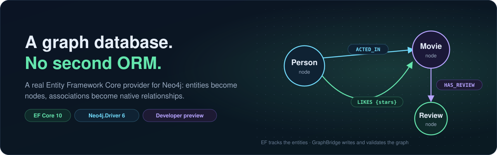

# GraphBridge documentation

GraphBridge is a real Entity Framework Core provider for Neo4j. EF Core owns your model, entity identity and change tracking; the official Neo4j .NET driver owns the connection; GraphBridge maps entities to nodes and relationships and translates queries into parameterized Cypher. It is a developer preview: every supported behavior is tested against a real Neo4j database, and every limit is written down.

## Start here

| | |
|---|---|
| [What is GraphBridge](WHAT_IS_GRAPHBRIDGE.html) | The visual introduction: the idea, the storage forms, the query surfaces and the tools ([open it on the documentation site](https://joslat.github.io/GraphBridge.EFCore/WHAT_IS_GRAPHBRIDGE.html)) |
| [Concepts](CONCEPTS.md) | The same ideas in words: how EF concepts map to the graph, and the three ways to query |
| [Getting started](GETTING_STARTED.md) | Install, configure `UseNeo4j`, map an entity, save it and see the Cypher |
| [Workshop](WORKSHOP.md) | 31 runnable lessons, about three hours for the core track |
| [Samples](SAMPLES.md) | Five complete applications to copy from |

## Features

| Area | Pages |
|---|---|
| Mapping the graph | [Mapping nodes](features/MAPPING_NODES.md) · [References](features/REFERENCES.md) · [Associations](features/ASSOCIATIONS.md) · [Identified relationships](features/IDENTIFIED_RELATIONSHIPS.md) |
| Querying | [LINQ queries](features/LINQ_QUERIES.md) · [Fluent Cypher](features/FLUENT_CYPHER.md) · [Native Cypher](features/NATIVE_CYPHER.md) · [Bounded paths](features/BOUNDED_PATHS.md) · [Graph search](features/GRAPH_SEARCH.md) · [Query inspection](features/QUERY_INSPECTION.md) |
| Writing | [Transactions and concurrency](features/TRANSACTIONS_AND_CONCURRENCY.md) · [Bulk mutations](features/BULK_MUTATIONS.md) · [Nulls, types and time](features/NULLS_TYPES_AND_TIME.md) |
| Operating | [Schema and migrations](features/SCHEMA_AND_MIGRATIONS.md) · [Command tracing](features/COMMAND_TRACING.md) |

Which query surface to use: [choosing a level](features/FLUENT_CYPHER.md#choosing-a-level).

## Tools

[Doctor](tools/DOCTOR.md) · [Verify](tools/VERIFY.md) · [Query Lab](tools/QUERY_LAB.md) · [Mapping generator](tools/MAPPING_GENERATOR.md) · [GraphBridge.Tool](tools/GRAPHBRIDGE_TOOL.md) · [Design-time commands](tools/DESIGN_TIME.md) · [Project template](tools/TEMPLATE.md)

None of the tools is needed at runtime. Doctor, Verify and Query Lab only read: they never write to your database.

## Reference

- [Compatibility](reference/COMPATIBILITY.md): the pinned stack, supported Neo4j versions and editions, and the breaking-change policy.
- [Known limitations](reference/KNOWN_LIMITATIONS.md): what is refused, with its code and the alternative.
- [Troubleshooting](reference/TROUBLESHOOTING.md) · [Packages and components](reference/PACKAGES_AND_COMPONENTS.md) · [Changelog](../CHANGELOG.md)

## Architecture

[Overview](architecture/ARCHITECTURE.md) · [Decision records](architecture/ARCHITECTURE_DECISIONS.md) · [EF service map](architecture/EF_SERVICE_MAP.md)

## Evidence and contributing

What was tested, and how, lives next to the tests: [verification summary](../tests/verification/VERIFICATION_SUMMARY.md), [feature evidence](../tests/verification/FEATURE_EVIDENCE.md), [capability evidence](../tests/verification/CAPABILITY_EVIDENCE.md), [EF conformance matrix](../tests/verification/EF_CONFORMANCE_MATRIX.md) and [Fluent Cypher acceptance](../tests/verification/FLUENT_CYPHER_ACCEPTANCE.md). To build and run the tests, see [tests/README](../tests/README.md) and [contributing](../CONTRIBUTING.md).
