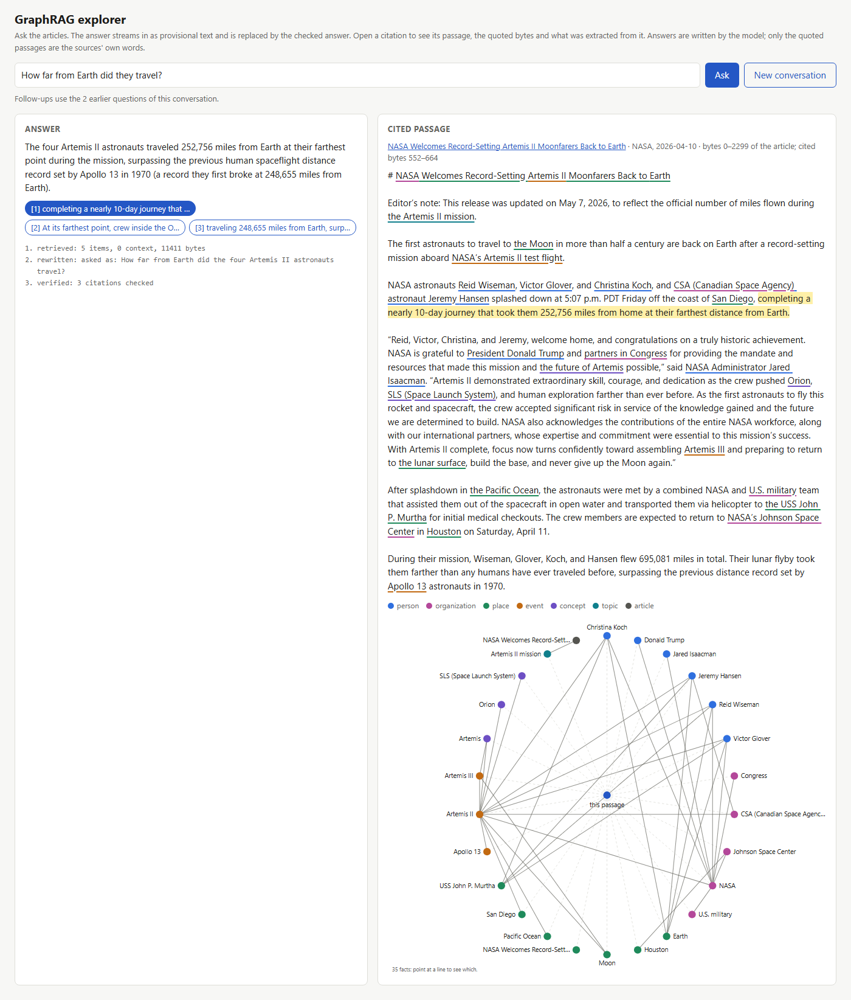

# 09 · GraphRAG articles

Extract the people, organisations, places, events, concepts and topics of news articles into a typed graph: who wrote each article, what it is about, who works where, and who said what. Then answer questions with checked citations: on the command line, through an Agent Framework agent, or streamed from the toolkit's endpoints. The sample uses the experimental [GraphRAG toolkit](../../src/GraphBridge.GraphRag/README.md) with its standard article ontology.

It reads any folder of Markdown articles. Their title, publication date, publisher and URL come from `articles.json` next to the folder, as the source's own metadata; they are never extracted. Two sets come with it:
- **Two fictional articles** in `data/articles`, written for this sample: Larkfield, its library and its people are invented. They are the default, and run offline with extraction replies written by hand.
- **NASA's Artemis II news releases**, from launch to splashdown, in `data/nasa`: the opening six paragraphs of each, made with `fetch data/nasa/articles --excerpt 6`. `fetch` downloads the whole releases.

## NASA's material

The five releases are NASA news releases [RELEASE26-026](https://www.nasa.gov/news-release/liftoff-nasa-launches-astronauts-on-historic-artemis-moon-mission/), [26-027](https://www.nasa.gov/news-release/nasas-artemis-ii-mission-leaves-earth-orbit-for-flight-around-moon/), [26-028](https://www.nasa.gov/news-release/nasas-artemis-ii-crew-eclipses-record-for-farthest-human-spaceflight/), [26-029](https://www.nasa.gov/news-release/nasas-artemis-ii-crew-beams-official-moon-flyby-photos-to-earth/) and [26-030](https://www.nasa.gov/news-release/nasa-welcomes-record-setting-artemis-ii-moonfarers-back-to-earth/), published 1 to 10 April 2026.
- **Licence:** NASA material is generally not subject to copyright in the United States; see [NASA's media usage guidelines](https://www.nasa.gov/nasa-brand-center/images-and-media/). The text holds no material credited to anyone else. `fetch` keeps headings and paragraphs, and leaves out image captions and the media contacts after the `-end-` line.
- **Answers are your model's, not NASA's.** NASA's guidelines ask that AI output is never attributed to NASA or presented as reviewed by it. The sample says which model wrote each answer; only the quoted passages, checked against the stored text, are NASA's words. Nothing here implies NASA's endorsement.

## Run it

Point the four `GRAPHBRIDGE_NEO4J_*` variables at an empty, disposable Neo4j 2026.09 or later database. Give each GraphRAG sample an empty database of its own: its schema is the database's first migration. Then:

```text
dotnet run --project samples/09-GraphRagArticles -- setup
dotnet run --project samples/09-GraphRagArticles -- ingest                  # the fictional articles
dotnet run --project samples/09-GraphRagArticles -- ingest nasa             # the NASA excerpts
dotnet run --project samples/09-GraphRagArticles -- report
dotnet run --project samples/09-GraphRagArticles -- ask "How far from Earth did the Artemis II crew travel?"
dotnet run --project samples/09-GraphRagArticles -- ask "When and where did Artemis II splash down?" --export answer.json
dotnet run --project samples/09-GraphRagArticles -- chat
dotnet run --project samples/09-GraphRagArticles -- graph "Which people work for NASA?"
dotnet run --project samples/09-GraphRagArticles -- agent "Who are the four Artemis II astronauts?"
dotnet run --project samples/09-GraphRagArticles -- serve
dotnet run --project samples/09-GraphRagArticles -- cleanup
```

- **`setup`** applies the schema plan as a migration. On a database that already has other migrations, it applies nothing, says why and exits 2.
- **`fetch folder [--excerpt n]`** downloads the five releases into `folder` and writes `articles.json` next to it. It needs no database. Then `ingest folder`.
- **`ingest [folder | nasa]`** reads the articles. Facts stated by several articles, such as a person working for an organisation, are stored once and list every article that states them.
- **`report`** prints, through typed LINQ over `Authored`, `About`, `WorksFor`, `LocatedIn<Organization>` and `Quoted`:
  - each article with its authors and topics;
  - who works where, and in how many articles that is stated;
  - which organisations are where;
  - every quotation with its speaker.
- **`ask`** answers with checked citations, or refuses. With `--export file.json`, it also writes the answer or refusal, its citations, evidence and receipt as one JSON document ([exporting an answer](../../docs/graphrag/ANSWERS.md#exporting-an-answer)).
- **`chat`** reads questions from the console until an empty line. Each follow-up is rewritten with the conversation so far into a question that stands alone, which it prints, then answered with checked citations ([follow-up questions](../../docs/graphrag/ANSWERS.md#follow-up-questions)). The sample keeps the history; the toolkit stores none.
- **`graph`** asks a question about the graph rather than a passage, with the experimental Text2Cypher: a model writes one read-only query, and the answer is its rows and the query, with no citations ([questions about the graph](../../docs/graphrag/ANSWERS.md#questions-about-the-graph-experimental)). The offline stand-in can't write Cypher, so it is refused offline; replay has the queries recorded for the NASA excerpts, such as the one above.
- **`agent`** asks a Microsoft Agent Framework `ChatClientAgent` with the toolkit's `GraphRagContextProvider`. The agent is told to answer through `answer_from_documents`, whose citations are checked, and the sample prints each tool call with the spans it returned; the agent's own wording isn't checked. Offline, a stand-in model always asks that tool; a real model decides for itself.
- **`serve`** hosts the toolkit's endpoints from [`GraphBridge.GraphRag.AspNetCore`](../../src/GraphBridge.GraphRag.AspNetCore/README.md) on `http://localhost:5179`, or the URL you give it (`serve http://localhost:5200`), plus `GET /report`. Besides `ask`, `POST /graphrag/search` returns passages and `GET /graphrag/documents/{id}` a document's metadata. `POST /graphrag/ask` streams the answer as server-sent events, then its checked citations or a refusal:

  ```text
  curl -N -X POST http://localhost:5179/graphrag/ask -H "Content-Type: application/json" -d "{\"question\": \"When and where did Artemis II splash down?\"}"
  ```

  That quoting is for bash and cmd. In PowerShell, write the body with single quotes: `curl.exe -N -X POST http://localhost:5179/graphrag/ask -H "Content-Type: application/json" -d '{\"question\": \"When and where did Artemis II splash down?\"}'`.

  It listens on localhost only, refuses any other URL and answers only requests addressed to localhost. Before serving anyone else, add your own authentication and rate limits to the whole app: the group `MapGraphRag` returns, `/report` and the explorer alike.

  It also serves the explorer at `http://localhost:5179/explorer`, described below.
- **`cleanup`** removes the articles and the things no longer mentioned anywhere.

## The explorer

`serve` hosts a page that shows what the toolkit does with a question ([`Explorer.cs`](Explorer.cs) and [`explorer.html`](explorer.html), no libraries):
- the answer streams in as provisional text, then the checked answer replaces it, with its citations;
- opening a citation shows its passage with the quoted bytes highlighted, and every mention underlined in its kind's colour;
- under it, the things extracted from the passage and the facts between them. The facts come from the toolkit's own `related_facts` tool, so the page shows what an agent sees. A question asked after another is a follow-up: the page sends the conversation so far, the event log shows how the question was rewritten, and **New conversation** starts over.



The screenshot was taken in replay mode, at zero model calls. `/explorer?q=...&cite=2` asks at once and opens the second citation; `&then=...` asks a follow-up after the first answer and opens that citation of the follow-up's answer instead.

## With a real model

On 26 October 2026, with GLM-5.3-Flash and `BAAI/bge-m3` on Bitdeer, over the NASA excerpts, and on 29 October for the explorer's follow-up. The 36 calls are recorded in `data/article-recordings.json`: 23 for ingestion and answers, 3 for the follow-up, and 10 for the [Text2Cypher](../../docs/graphrag/ANSWERS.md#questions-about-the-graph-experimental) evaluation. The real-model tests replay them at zero calls, and so does the sample with `GRAPHBRIDGE_AI_MODE=replay`, for the recorded questions, as in the [tutorial](../../docs/graphrag/TUTORIAL.md). The shipped articles are named by their address in the repository, so the replay works in any clone.

| | |
|---|---|
| Ingestion | 5 releases, 5 passages; 5 extraction calls, 8,988 input and 143,981 output tokens (most of it the model's reasoning) |
| Extracted | 93 things, 154 mentions, 112 facts, 7 quotations; no reply unreadable, none repaired |
| Pruned, with reasons | 2 `ABOUT` relationships from a person to a quotation (`pattern-not-allowed`); a topic whose quote isn't in the passage (`quote-not-found`), and the entity and relationship that depended on it |
| Report | the four astronauts and their agencies, each stated in four releases; NASA officials with their roles; quotations by Lori Glaze, Nicky Fox and Jared Isaacman |
| Questions | how far the crew travelled, who the four astronauts are, when and where they splashed down: answered, every citation the release's own bytes; an unrelated question refused |
| Agent | asked how far the crew travelled, it called `answer_from_documents` and `search_documents` itself, then answered |

Every mention and quotation is checked against the file's bytes in the test. The answer text is the model's; only the cited quotations are checked.

## Models

Offline, the sample uses stand-ins: hashed embeddings, an extractive answerer, the hand-written extraction replies for the fictional articles (other articles extract nothing), and the agent stand-in. With a real model, configured as in [sample 08](../08-GraphRagNovel/README.md) (`AI_INFERENCE_PROVIDER=bitdeer` and `BITDEER_API_KEY`), every step uses it. `GRAPHBRIDGE_AI_MODE=replay` replays the calls recorded in `data/article-recordings.json` at zero calls. A named provider wins: with `AI_INFERENCE_PROVIDER` set, `GRAPHBRIDGE_AI_MODE=replay` is ignored, the calls go to the model, and the sample says so on its first line. The schema names the embedding model, so a database set up offline can't then run with a model, or the reverse: give each mode its own empty database.

The ontology's labels are prefixed with `GraphRagOntologies.Article.WithLabelPrefix("News")`, so `NewsPerson` and `NewsPlace` don't collide with sample 08's `Place` and `Event` in a shared database. The kinds shown to the model and the relationship types stay the same.
